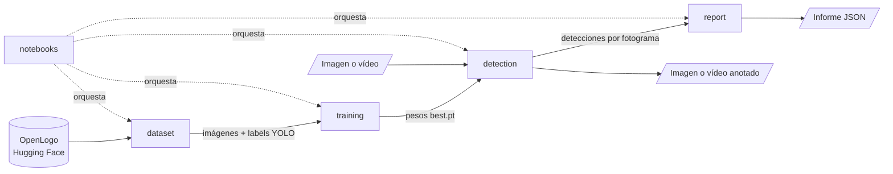
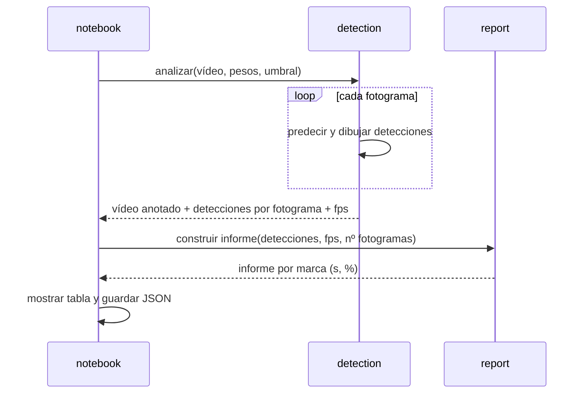

# ARCHITECTURE

> Cómo está construido el sistema y hacia dónde va. Mapa de documentación: [WORKFLOW](../WORKFLOW.md#2-mapa-de-documentación).

## 1. Visión general

Un paquete Python (`logo_detector`) agrupa todo el sistema. Sus módulos preparan el dataset, reentrenan un detector YOLO preentrenado, aplican el modelo a imágenes y vídeos, y calculan el informe de exposición. Los notebooks de demo (`.py` con jupytext, convertidos a `.ipynb` con `make`) solo orquestan esos módulos y muestran los resultados. El entrenamiento se ejecuta en una GPU de Google Colab; la inferencia y la demo, en local o en Docker con CPU.



## 2. Stack

| Área | Tecnología | Estado | Decisión |
|---|---|---|---|
| Lenguaje | Python 3.12 | Actual | [ADR-0002](ADR/0002-python-environment-and-notebooks.md) |
| Dependencias | uv (`pyproject.toml` + `uv.lock`) | Actual | [ADR-0002](ADR/0002-python-environment-and-notebooks.md) |
| Detector | Ultralytics YOLO, variante nano o small preentrenada en COCO | Actual | [ADR-0001](ADR/0001-ultralytics-yolo-detector.md) |
| Deep learning | PyTorch para CPU (índice de PyTorch), dependencia de Ultralytics | Actual | [ADR-0001](ADR/0001-ultralytics-yolo-detector.md) |
| Procesado de imagen y vídeo | OpenCV | Actual | [ADR-0001](ADR/0001-ultralytics-yolo-detector.md) |
| Descarga del dataset | `huggingface_hub` (descarga selectiva de `Voxel51/OpenLogo`) | Actual | [ADR-0003](ADR/0003-selective-openlogo-download.md) |
| Notebooks | Jupyter + jupytext (formato percent) | Actual | [ADR-0002](ADR/0002-python-environment-and-notebooks.md) |
| Entrenamiento | Google Colab con GPU | Actual | [ADR-0001](ADR/0001-ultralytics-yolo-detector.md) |
| Entorno de ejecución | Docker (imagen CPU) | Actual | [ADR-0002](ADR/0002-python-environment-and-notebooks.md) |
| Calidad | ruff, pytest | Actual | — |

## 3. Componentes

| Componente | Responsabilidad | Datos que posee | Depende de | Estado |
|---|---|---|---|---|
| `dataset` | Descarga OpenLogo, filtra las tres marcas, convierte las anotaciones a formato YOLO y crea las particiones (RF-01) | `data/` | OpenLogo, `huggingface_hub` | Actual |
| `training` | Reentrena el detector con preprocesamiento y aumento de datos, y reporta métricas (RF-02) | `models/` (pesos), `runs/` | `dataset`, Ultralytics | Actual |
| `detection` | Aplica el modelo a imágenes y vídeos y dibuja bounding box, marca y confianza (RF-03, RF-04) | — | `training` (pesos), OpenCV | Objetivo |
| `report` | Calcula la exposición por marca a partir de las detecciones por fotograma y la guarda en JSON (RF-05, RD-01…RD-04) | `outputs/` (`<vídeo>_report.json`) | `detection` (detecciones por fotograma) | Actual |
| `notebooks` | Demo y presentación de punta a punta (RF-06) | — | Todos los anteriores | Objetivo |

`report` es lógica pura (detecciones → informe), sin dependencia del modelo, para poder probarla de forma aislada. Recibe una lista de detecciones (marca y confianza) por fotograma, que `detection` debe producir; el comportamiento está en la spec [`report`](../openspec/specs/report/spec.md).

## 4. Estructura del repositorio

```text
.
├── src/logo_detector/   # dataset.py, training.py, detection.py, report.py, config.py
├── notebooks/           # *.py en formato jupytext; los .ipynb se generan y no se versionan
├── tests/
├── data/                # dataset descargado y preparado (no versionado)
├── models/              # pesos entrenados (no versionado; se publican como asset de release)
├── outputs/             # vídeos anotados e informes (no versionado)
├── Dockerfile
├── Makefile
├── pyproject.toml
├── docs/
└── openspec/
```

## 5. Flujos principales

### Análisis de un vídeo



Errores: si el archivo no se puede abrir como vídeo, `detection` lanza un error con un mensaje claro (RF-04). Si no existen los pesos, se indica cómo obtenerlos.

## 6. Datos, configuración y secretos

- **Persistencia:** archivos locales. `data/` guarda el dataset; `models/`, los pesos; `outputs/`, los vídeos anotados y los informes JSON. Nada de eso se versiona. No hay base de datos ([PROJECT §6](PROJECT.md#6-alcance)).
- **Configuración:** parámetros por defecto en `config.py` (marcas, rutas, umbral de confianza del 50 %, tamaño de imagen); se pueden sobrescribir por argumento.
- **Secretos:** ninguno. OpenLogo se descarga sin autenticación.
- **Datos enviados a terceros:** ninguno; solo se descargan el dataset y los pesos preentrenados.

## 7. Entorno local y operación

El `Makefile` es la fuente de verdad de los comandos. Los principales:

- `make install`: `uv sync`.
- `make notebooks`: genera los `.ipynb` desde `notebooks/*.py` con jupytext.
- `make data`: descarga y prepara el dataset.
- `make lint`, `make format` y `make test`: ruff (lint y formato) y pytest.
- `make docker-build` y `make docker-run`: construyen y arrancan el contenedor con Jupyter.

El entrenamiento se lanza desde `notebooks/02_training` en Google Colab con GPU (el `.ipynb` se sube a mano; Colab usa Python 3.13 y el paquete se instala con `--ignore-requires-python`). Usa la configuración de `training.TRAIN_CONFIG`, guarda los mejores pesos como `brands.pt` y los descarga; se copian a `models/`. Los pasos están en el README.

## 8. Calidad: tests, CI y observabilidad

- **Unitarios (pytest):** `report` (cálculo de exposición y reglas RD) y la conversión de anotaciones de `dataset`.
- **Integración:** detección sobre una imagen y un vídeo corto de ejemplo cuando haya pesos; no se ejecuta en el CI.
- **Calidad del modelo:** métricas de validación del entrenamiento (RNF-03), sin test automático. Último entrenamiento (2026-11-04, #10): YOLO26 nano, `TRAIN_CONFIG` sin cambios, dataset OpenLogo en la revisión de `config.py`, Colab (Tesla T4, Python 3.13, torch 2.11 con CUDA, Ultralytics 8.4.202). Validación evaluada en local con CPU; en Colab da lo mismo con diferencias de mAP ≤ 0,002:

  | Marca | Precisión | Recall | mAP@0.5 | mAP@0.5:0.95 |
  |---|---|---|---|---|
  | Todas | 0,846 | 0,786 | **0,851** | 0,543 |
  | Coca-Cola | 0,845 | 0,822 | 0,877 | 0,583 |
  | Pepsi | 0,811 | 0,795 | 0,827 | 0,595 |
  | Adidas | 0,882 | 0,740 | 0,850 | 0,451 |

  Cumple RNF-03 (mAP@0.5 ≥ 0,6). Inferencia en CPU (Ryzen 5 5600): ~28 ms por imagen de 640 px.
- **CI:** `openspec validate`, ruff (lint y formato), pytest y `docker build`.
- **Observabilidad:** logs en consola y métricas de entrenamiento de Ultralytics en `runs/`.

## 9. Despliegue

No hay despliegue: el producto es una demo local con notebooks, ejecutable en Docker. Servir el modelo en cloud queda fuera de alcance ([PROJECT §6](PROJECT.md#6-alcance)).

## 10. Decisiones y contratos

- Decisiones técnicas: [índice de ADR](ADR/README.md).
- Interfaces estables: [índice de contratos](CONTRACTS/README.md). No hay contratos: todas las piezas viven en el mismo paquete.
